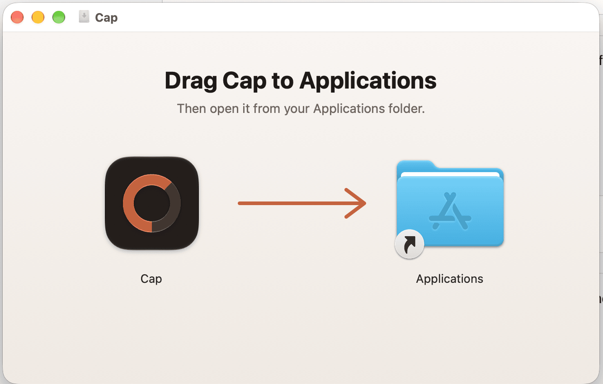
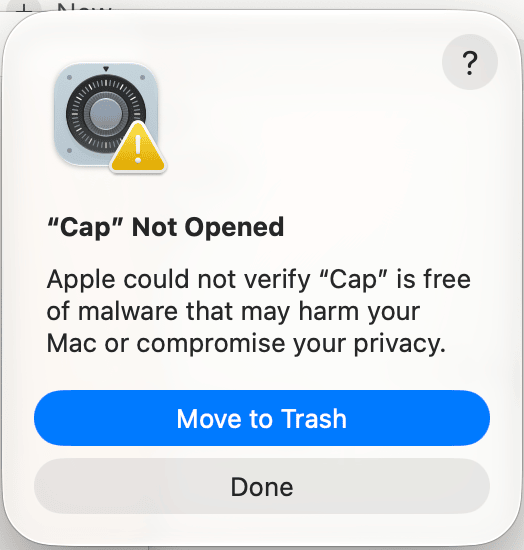
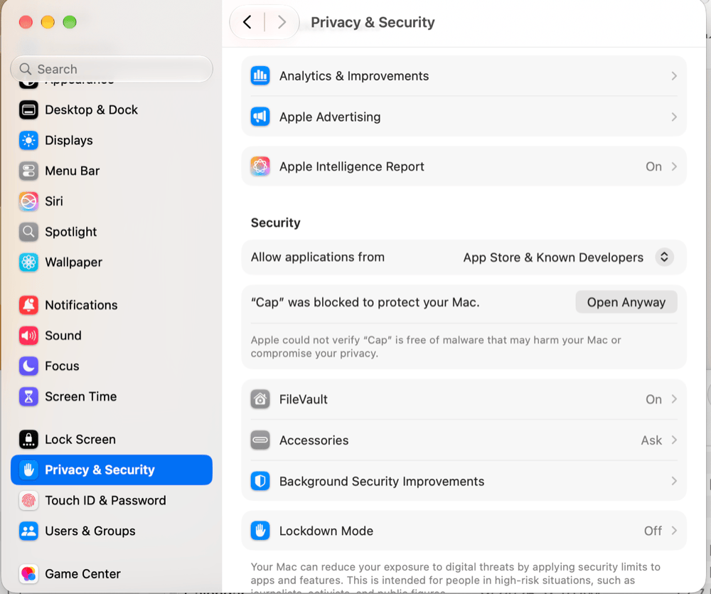
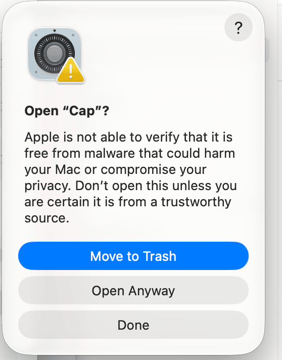
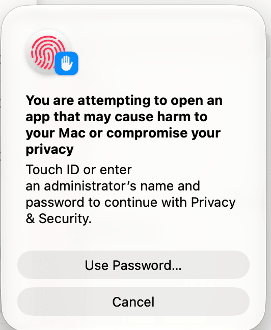
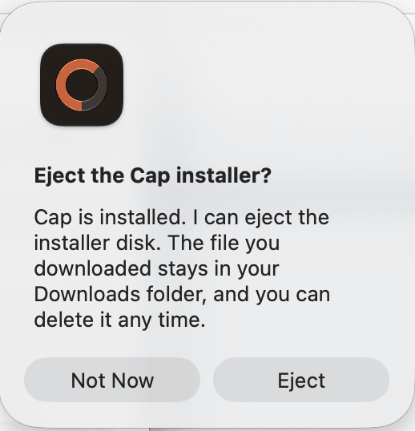

# Installing Cap

Cap is free and open source, and it is not yet notarized by Apple. That means macOS will stop it the first time you open it and ask you to confirm. This page walks through every step, so nothing on the screen is a surprise.

**About 3 minutes. You will need Touch ID or your Mac password once.**

## Before you start

- macOS 13 or later, on an Apple silicon Mac (M1 or newer).
- Claude Code or the Claude desktop app, signed in with a **Pro, Max or Ultra** plan.
- The screenshots below are in English. On a Mac set to another language, the wording will differ but the steps are the same.

## Why there is a warning

Apple checks apps from developers who are enrolled in its paid developer programme (a yearly fee) and "notarizes" them. Cap is a free hobby project and is not enrolled yet. Notarization is planned, with no date. When it happens, this page gets much shorter.

The warning does not mean something is wrong with Cap. It means Apple has not run its checks. You do not have to take Cap's word for it:

- **Read it.** All of the code is in this repository.
- **Build it yourself.** See "Build from source" in the [README](README.md).
- **Check your download.** Each release page shows a SHA-256 fingerprint. In Terminal, run `shasum -a 256 ~/Downloads/Cap-<version>.dmg` and compare the result. If they differ, do not open it.

## Step 1. Download

Download `Cap-<version>.dmg` from the [Releases](../../releases) page.

The first time, Safari may ask whether to allow downloads on `release-assets.githubusercontent.com`. That is the address GitHub uses to serve release files. Click **Allow**.

## Step 2. Move Cap into Applications

Open the downloaded file and drag **Cap** onto **Applications**.



## Step 3. Open Cap, and let macOS stop it

Open **Cap** from Applications. macOS shows a message that it cannot verify Cap.



Click **Done**. The blue button is **Move to Trash**, so take care: you want the grey one underneath.

## Step 4. Allow Cap in System Settings

1. Open **System Settings** and choose **Privacy & Security**.
2. Scroll down to the **Security** section. You will see "Cap was blocked to protect your Mac."
3. Click **Open Anyway**.



If you cannot see that line, open Cap once more (Step 3) and come back. macOS only shows it after it has stopped the app.

## Step 5. Confirm that you want to open it

macOS asks once more. Click **Open Anyway**.



## Step 6. Use Touch ID or your password

Finally macOS asks you to prove it is you. Use Touch ID, or choose **Use Password…** and type your Mac password.



Cap opens. Once Cap is running from Applications, macOS may ask whether to eject the installer disk. Click **Eject** to clear it, or **Not Now** to keep it open. Your downloaded file stays in Downloads either way.



Then Cap's welcome window takes it from here.

## Other messages you can expect

- **"Cap would like to send you notifications."** This is your choice. Cap uses them for limit alerts and sign-in reminders. You can change it later in Cap's Settings.
- **"Cap can run in the background."** If you turn on "Open Cap at login", macOS tells you about it. That is expected.
- **A Claude sign-in window.** If you are signed out of Claude Code, Cap asks Claude Code to start its normal browser sign-in. You sign in with Claude directly. Cap never sees your password.

<!-- SCREENSHOT STILL NEEDED: notifications prompt, background banner (capture during the clean-user test) -->

## Updates

If you turn on automatic checks, Cap checks GitHub once a day and shows a small red dot on its Settings icon when a new version is out. You can also check by hand at any time. It never installs anything by itself. Until Cap is notarized, each new version needs Steps 3 to 6 again.

## Prefer Terminal?

<details>
<summary>Skip the clicks (for people who are comfortable with Terminal)</summary>

After moving Cap into Applications, run:

```bash
xattr -dr com.apple.quarantine /Applications/Cap.app
```

This removes the "downloaded from the internet" mark, so macOS stops asking. It also skips the check, so only do it for a download you have verified with the fingerprint above.

</details>

## Something not working?

Open an [issue](../../issues) and say what you saw. Please do not include your Claude login, tokens or conversations. Cap never needs them. To remove Cap, see "Uninstall" in the [README](README.md).
