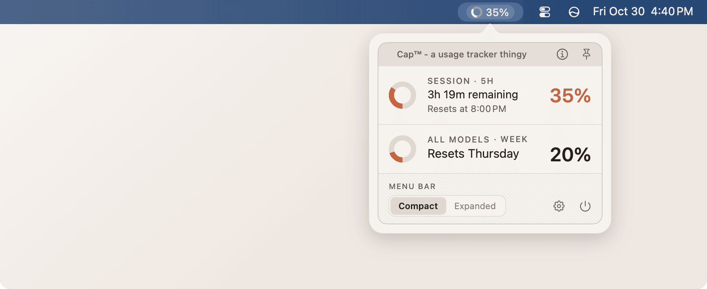
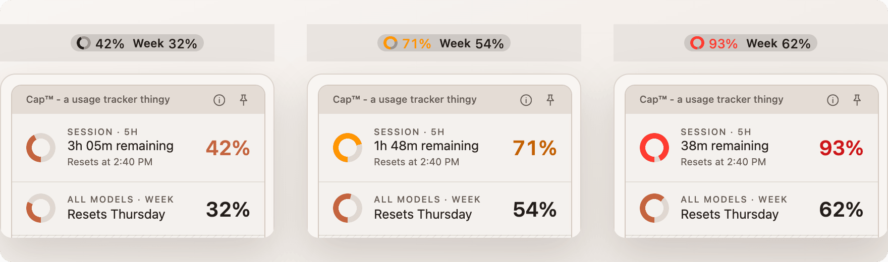
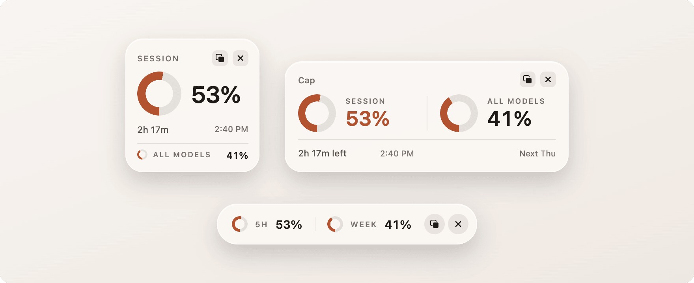
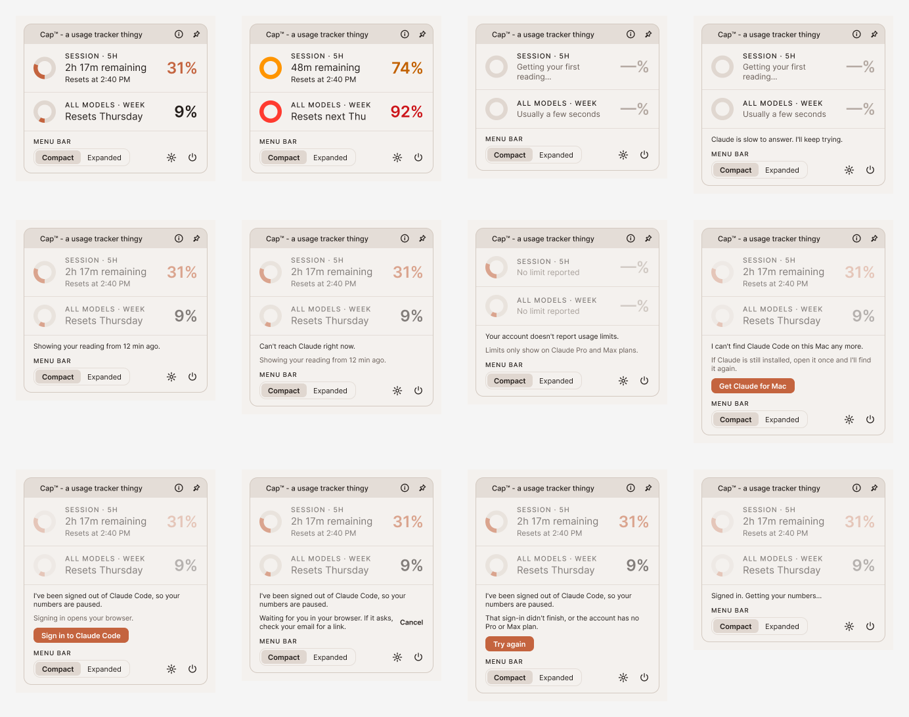

<p align="center">
<picture>
  <source media="(prefers-color-scheme: dark)" srcset="assets/readme/header-dark.png">
  
</picture>
</p>

<h1 align="center">Cap - a usage tracker thingy for Claude</h1>

<p align="center"><b>Your Claude plan usage, live in the Mac menu bar.</b></p>

<p align="center"><a href="https://cap.kelson.ai"><b>See me in action at cap.kelson.ai</b></a> · <a href="https://cap.kelson.ai/faq/">FAQ</a></p>

> **Make the costs of AI visible, so using it responsibly becomes a habit.** Read the [vision and principles](VISION.md).

Cap is a small, free menu bar app for people who use Claude Code or the Claude desktop app on a Pro, Max or Ultra plan. It shows how much of your 5-hour session and your weekly limit you have used, and when each resets, so you find out *before* you hit the wall.

> **Unofficial.** Cap is an independent project. It is not made by, affiliated with, or endorsed by Anthropic. "Claude" is a trademark of Anthropic.

<p align="center">
<picture>
  <source media="(prefers-color-scheme: dark)" srcset="assets/readme/hero-dark.png">
  
</picture>
</p>
<p align="center"><em>I live in your menu bar. Click me to see both of your Claude limits and when they reset.</em></p>

## What you get

- **A dial and a number in your menu bar.** Compact (session only) or Expanded (session and week).
- **A popover** with both readings and their reset times.
- **An optional pinned widget** (Small, Medium or Strip) that follows your Mac's *Icon & widget style* setting.
- **Alerts** when you pass a percentage you choose, and when you are signed out of Claude Code.
- **Nothing to configure.** Cap refreshes every 15 seconds while you are at your Mac and pauses while you are away.
- **No account, no analytics.** See [PRIVACY.md](PRIVACY.md) for exactly what Cap reads, writes and sends.

<p align="center">
<picture>
  <source media="(prefers-color-scheme: dark)" srcset="assets/readme/states-dark.png">
  
</picture>
</p>
<p align="center"><em>I stay terracotta while you're fine, turn orange at 70% and red at 90%.</em></p>

<p align="center">
<picture>
  <source media="(prefers-color-scheme: dark)" srcset="assets/readme/widgets-dark.png">
  
</picture>
</p>
<p align="center"><em>Pin me to your desktop as Small, Medium or a thin Strip.</em></p>

## Requirements

- macOS 13 or later, Apple silicon (arm64).
- Claude Code or the Claude desktop app, signed in with a **Pro, Max or Ultra** account. Verified Ultra accounts have no 5-hour limit, so for now Cap's Session figure is empty for them and only the weekly figure shows.

**About signing in:** Cap reads your numbers through your own Claude Code sign-in, and Claude Code sign-ins last about a month. Cap tells you a week ahead (and again two days ahead) and renews it with one browser approval, about a minute, at a time you choose. If a sign-in ever ends before you renew it, the menu bar says so and one click signs you in again. The week-ahead warning needs a recent Claude Code (version 2.1.318 or later).

## Install

1. Download `Cap-<version>.dmg` from the [Releases](../../releases) page.
2. Open it and drag **Cap** onto **Applications**.
3. Open Cap. The welcome window walks you through the rest in five short steps.

**Signed and notarized.** Cap is signed with an Apple Developer ID and checked by Apple's notary service, so the first time you open it macOS only asks whether you want to open an app downloaded from the internet. [INSTALL.md](INSTALL.md) has the details. Cap is open source: you can read every line, or build it yourself (below).

## How it works, in plain words

Every 15 seconds, while you are at your Mac, Cap runs the copy of Claude Code that is already on your Mac with a tiny one-word request, and reads the usage figures Claude Code reports back (how much of each limit is used and when it resets). Each refresh is a very small request, so its cost to your plan is negligible, and you never need to choose a rate.

Cap never asks for, sees or stores your password, your login token or anything from your Keychain. If you are signed out, Cap asks Claude Code to start its normal browser sign-in, and you authenticate with Claude directly.

## Uninstall

1. Quit Cap (power button in its popover).
2. Drag **Cap** from Applications to the Trash.
3. Optional, to remove everything Cap saved:
   - If **Cap** is listed under **System Settings > General > Login Items & Extensions**, remove it there.
   - In Terminal, run `rm -rf ~/.claude_usage_widget` and `defaults delete ai.kelson.cap`.

## Build from source

```bash
git clone https://github.com/bkelson/cap.git
cd cap
swift build -c release          # builds .build/release/Cap
scripts/run-harness.sh          # logic tests (about 2 minutes)
scripts/make-dmg.sh             # builds dist/Cap-<version>.dmg (ad hoc signed)
```

You need a recent Swift toolchain (Swift 6.2 / Xcode 26). There are no third-party dependencies.

## Updates

If you turn on "Check for updates automatically" in Settings, Updates, Cap checks GitHub once a day for a newer release and tells you with a small red dot on its Settings icon. It's off until you choose to turn it on. It never downloads or installs anything by itself: *Download* opens the release page in your browser.

## Design

The whole design file is free to copy: the design system (color, spacing, radius and type tokens, text styles and components), every app screen and the click-through prototype.

<p align="center">
<a href="https://www.figma.com/community/file/1707045222778979547"></a>
</p>

[Open the Figma file](https://www.figma.com/community/file/1707045222778979547), duplicate it, publish your copy as a library and build on it. It is free to reuse with credit (CC BY 4.0). The rules, the page map and how to suggest changes are in [DESIGN.md](DESIGN.md).

## Status and roadmap

Cap is new. [See the roadmap](ROADMAP.md): a plan, not a promise. For what Cap is for and the principles it keeps, read [VISION.md](VISION.md).

## Limits of this approach

Cap reads what Claude Code reports. If Anthropic changes that output, Cap may need an update. Cap measures your plan limits as Claude Code sees them, not billing.

## License

The code is released under the [MIT License](LICENSE) © 2026 Brian Kelson.

The Cap name, icon and logo (the files in `assets/` and the app icon) are © Brian Kelson and are **not** covered by the MIT License. You are welcome to fork Cap and build on it, but please give your version its own name and icon so people can tell it apart from this one.

Made with ♥ for the Claude community.
